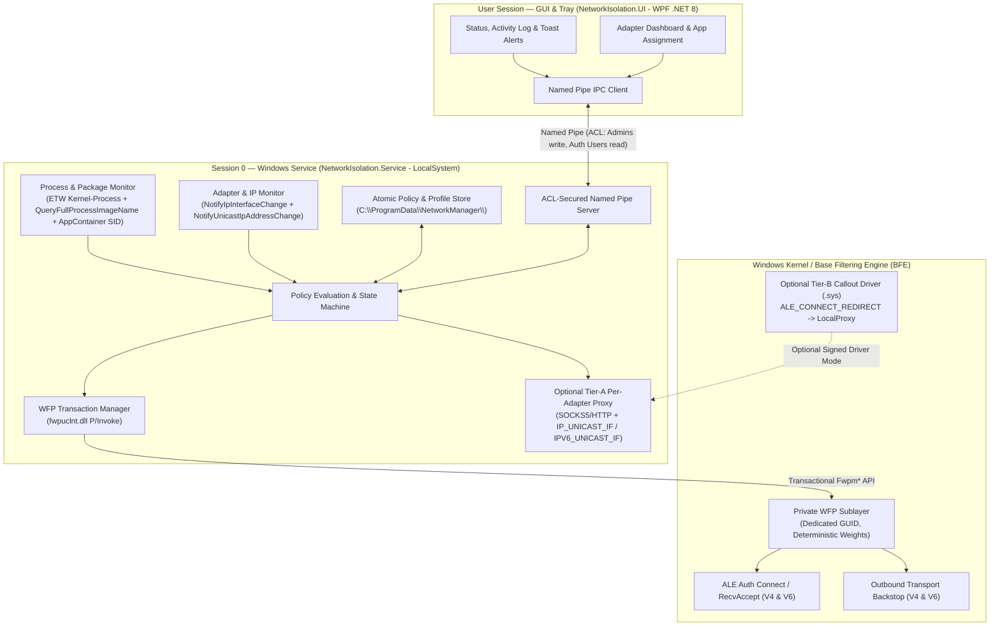

# System Architecture — Closed Per-App Network Kill-Switch & .NET 8 WFP Toolkit

**Inputs:** [PROJECT_SPEC.md](PROJECT_SPEC.md), [TECHNICAL_RESEARCH.md](TECHNICAL_RESEARCH.md)  
**Target OS:** Windows 10 (1809+) and Windows 11  
**Runtime:** .NET 8 (LTS)

---

## 1. Architectural Reconciliation & Core Guarantee

A critical finding of Phase 1 ([TECHNICAL_RESEARCH.md](TECHNICAL_RESEARCH.md)) corrects a common assumption reflected in [PROJECT_SPEC.md §2.1 NFR-2.1.2](PROJECT_SPEC.md#L250-L258):

> **Architectural Truth:** `FWPM_LAYER_ALE_BIND_REDIRECT_V4/V6` and `FWPM_LAYER_ALE_CONNECT_REDIRECT_V4/V6` **cannot** be used from user-mode WFP management APIs (`Fwpm*`)—they require a signed kernel-mode WFP Callout Driver (`FwpsCalloutRegister*`). Furthermore, user-mode WFP filter conditions (`FWPM_CONDITION_IP_LOCAL_INTERFACE`, `FWPM_CONDITION_INTERFACE_INDEX`) evaluate *after* Windows TCP/IP performs route lookup; they can **allow or block** an interface, not **force** Windows to choose a higher-metric interface for an arbitrary unmodified third-party socket.

Therefore, this architecture enforces **honest separation between Enforcement and Steering**, with zero fake UI-only binding:

| Capability | Mechanism | Guarantee | Signing / Env Prerequisite |
| :--- | :--- | :--- | :--- |
| **1. Strict Fail-Closed Isolation (MVP Core)** | User-mode WFP (`Fwpm*`) managed by a `LocalSystem` Windows Service across ALE + Transport layers (IPv4 & IPv6) | **100% genuine fail-closed enforcement.** If traffic is routed to any non-allowed adapter (including after disconnect), WFP blocks it. Zero silent fallback. | None beyond standard Windows Admin/Service install. Builds with installed `.NET 8` SDK. |
| **2. Explicit Interface Steering (Tier A — Driver-Free)** | Per-adapter local SOCKS5/HTTP proxy inside the service using `IP_UNICAST_IF` / `IPV6_UNICAST_IF` + source IP binding | Forces proxy-capable apps (browsers, curl, git, torrent clients) onto *any* chosen adapter regardless of Windows route metrics, while WFP blocks direct non-loopback egress. | None (user-mode service). |
| **3. Transparent Arbitrary-App Steering (Tier B — Optional Phase 2B/3 Module)** | KMDF Kernel WFP Callout Driver (`ALE_CONNECT_REDIRECT_V4/V6` -> local service proxy, or validated `ALE_BIND_REDIRECT_V4/V6`) | Redirects unmodified arbitrary sockets onto a specific non-default adapter transparently, backed by Tier 1 WFP fail-closed rules. | Requires WDK + Test Signing (dev) or EV Certificate + Microsoft Hardware Dev Center WHQL/Attestation Signing (production). |

---

## 2. High-Level System Architecture

---

## 3. Technology Stack Selection

**Platform Requirements:**
- **.NET 8 SDK (LTS)** on Windows 10/11 (builds all user-mode projects out of the box with zero external C++ dependencies).
- **Selected Stack:**
  1. **Core Solution (`NetworkIsolation.sln`) — .NET 8 (LTS), C# 12:**
     - `NetworkIsolation.Core`: Shared models, LUID/GUID types, policy schema, validation, path/package canonicalization.
     - `NetworkIsolation.Service`: Windows Service (`Microsoft.Extensions.Hosting.WindowsServices`), source-generated `[LibraryImport]` P/Invoke directly against `fwpuclnt.dll`, `iphlpapi.dll`, `ws2_32.dll`, and `advapi32.dll`. Zero unmanaged runtime gaps; compiles immediately on the installed `.NET 8` SDK.
     - `NetworkIsolation.UI`: WPF desktop app (.NET 8) with system tray support, Windows 11 Fluent styling, UI Automation accessibility properties, and UAC elevation prompt only when modifying policies/service state.
     - `NetworkIsolation.Cli`: Headless CLI / PoC harness for Phase 2 automated WFP verification and CI/integration testing without GUI dependencies.
     - `NetworkIsolation.Tests`: xUnit unit + mocked WFP/adapter tests + elevated integration test suite.
  2. **Optional Kernel Driver (`NetworkIsolation.Driver`, Phase 3 / Gated):**
     - C / KMDF + WFP (`fwpsk.h`), isolated in its own directory and only built when Visual Studio C++ + WDK + driver-signing toolchain are explicitly provisioned.

---

## 4. Detailed Subsystem Design

### 4.1 WFP Sublayer, Layers, and Filter Weight Hierarchy

All filters live inside a single dedicated WFP Provider (`PROVIDER_GUID`) and Sublayer (`SUBLAYER_GUID`) registered with weight `0x8000` (coexisting cleanly with Windows Defender Firewall and VPN kill switches without disabling them).

**Layers enforced symmetrically for IPv4 and IPv6:**
1. `FWPM_LAYER_ALE_AUTH_CONNECT_V4` & `FWPM_LAYER_ALE_AUTH_CONNECT_V6` — Authorizes outbound TCP connects and initial UDP flows per `ALE_APP_ID` / `ALE_PACKAGE_ID`.
2. `FWPM_LAYER_ALE_AUTH_RECV_ACCEPT_V4` & `FWPM_LAYER_ALE_AUTH_RECV_ACCEPT_V6` — Prevents unexpected inbound/listen leaks on non-allowed adapters when strict isolation is active.
3. `FWPM_LAYER_OUTBOUND_TRANSPORT_V4` & `FWPM_LAYER_OUTBOUND_TRANSPORT_V6` — Defense-in-depth packet backstop catching already-authorized flows or unconnected UDP `sendto` re-routing attempts after an adapter disconnects.
4. *(Phase 2 Verification Gate)* `FWPM_LAYER_ALE_FLOW_ESTABLISHED_V4/V6` or explicit WFP policy re-authorization + optional TCP socket teardown (`SetTcpEntry` / `MIB_TCP_STATE_DELETE_TCB`) when `terminateOnDisconnect` is enabled.

**Filter Weight Ordering (inside our Sublayer, highest weight evaluated first):**

| Priority Tier | Weight (uint64 / auto-range) | Action | Condition Scope | Notes |
| :--- | :--- | :--- | :--- | :--- |
| **1. Loopback Exemption** | Highest (`15`) | `PERMIT` | `ALE_APP_ID` / `PACKAGE_ID` + Loopback Interface LUID (`IF_TYPE_SOFTWARE_LOOPBACK`) or `127.0.0.0/8`, `::1` | Enabled by default (`allowLoopback: true`). Allows local IPC & Tier-A local proxy. |
| **2. Link-Local / Control Scope (Optional)** | High (`12`) | `PERMIT` or `BLOCK` | Assigned interface LUID + `fe80::/10`, `169.254.0.0/16` | Never permitted on *other* interfaces; strictly scoped to allowed interface(s) only. |
| **3. Allowed Adapter(s)** | Medium (`10`) | `PERMIT` | `ALE_APP_ID` / `PACKAGE_ID` + `FWPM_CONDITION_IP_LOCAL_INTERFACE == AllowedAdapter.Luid` (only when adapter state is `Up` & valid!) | **Key fail-closed rule:** If allowed adapter is down/disconnected/unassigned, **no Permit filter exists** (or it is removed inside an atomic transaction while Block remains). |
| **4. Default-Deny Fallback Blocker** | Base (`1`) | `BLOCK` | `ALE_APP_ID` / `PACKAGE_ID` (all non-exempt outbound/inbound traffic) | **Always present** for `Bind`, `AllowMultiple`, and `BlockAll` policies. Guarantees zero silent fallback during state transitions or adapter loss. |

> **Atomic Transition Rule:** Filter updates MUST execute inside `FwpmTransactionBegin0` / `FwpmTransactionCommit0`. The Base `BLOCK` filter for a managed app is **never** removed prior to installing/updating `PERMIT` filters, eliminating transient leak windows.

> **Boot & Crash Fail-Safe:**
> - **Fail-Closed Mode (Default):** Persistent WFP provider/sublayer/filters (`FWPM_FILTER_FLAG_PERSISTENT`) remain active in BFE across service crashes and early boot *before* user logon.
> - **Fail-Open Mode (Opt-in):** Dynamic session (`FWPM_SESSION_FLAG_DYNAMIC`) automatically purges filters if the service terminates unexpectedly.

### 4.2 Stable Adapter Identification & State Machine

Adapters are **never** keyed by mutable display names (`"Ethernet"`, `"Wi-Fi 2"`) or volatile `InterfaceIndex` alone:
- **Primary Key:** `NET_LUID` (`uint64 Value`) — persistent across reboots and adapter renames.
- **Secondary Key:** `InterfaceGuid` (`Guid`) — correlates hardware/virtual adapters and displays user warnings if a USB NIC is swapped for a different unit (new LUID/GUID).
- **Runtime Field:** `InterfaceIndex` (`uint32`) — resolved dynamically via `ConvertInterfaceLuidToIndex` for display and `IP_UNICAST_IF`.

**Adapter Event Sources:**
- `NotifyIpInterfaceChange(AF_UNSPEC, ...)` — Media/interface up/down & metric changes.
- `NotifyUnicastIpAddressChange(AF_UNSPEC, ...)` — IPv4/IPv6 address assignment/removal (detects DHCP/SLAAC completion or loss).
- Debounced 1-second fallback reconciliation loop to catch missed NSI events.

**Adapter State Machine:**
`Unknown / Absent` -> `Present (Down / No IP)` -> `Up (Ready: IPv4 and/or IPv6 valid)` -> `Disconnected / Disabled` -> *Immediate removal of Tier-3 `PERMIT` filter inside WFP transaction; Tier-4 `BLOCK` holds immediately.*

### 4.3 Application Identity, Multi-Process Trees & UWP

- **Desktop Executables:** Canonical NT device path (`QueryFullProcessImageName` / `\Device\HarddiskVolume...` normalized to Win32 path + `FwpmGetAppIdFromFileName0` blob). Optionally records Authenticode publisher/SHA-256 to warn on binary changes (`PROJECT_SPEC.md §6.6`).
- **Packaged / UWP Apps:** Identified by Package Family Name -> AppContainer SID (`FWPM_CONDITION_ALE_PACKAGE_ID`).
- **Child Process & Multi-Process Apps:**
  - *Same-executable multi-process apps (Chrome, Edge, Electron):* `ALE_APP_ID` natively matches every process instance of that executable without polling races.
  - *Different-executable child processes (launchers, CLI pipelines):* Monitored via ETW (`Microsoft-Windows-Kernel-Process`) so if `inheritChildProcesses` is enabled on a policy, newly spawned child executables receive a dynamic inherited rule set scoped to the policy lifecycle (with safe exclusions for protected system binaries).
- **Protected System Safeguard:** Built-in hard/soft exclusion list (`csrss.exe`, `wininit.exe`, `lsass.exe`, `services.exe`, `smss.exe`, `TrustedInstaller.exe`, `MsMpEng.exe`, and shared `svchost.exe` unless service-SID scoped) prevents accidental OS bricking.

### 4.4 The DNS Client (`dnscache`) Edge Case

Windows apps calling `getaddrinfo()` / `DnsQuery()` normally route DNS through the shared `Dnscache` (`svchost.exe`) service rather than sending UDP/53 packets directly. This creates a major leak & isolation risk:
1. **Risk 1 (Leak):** `svchost.exe` (`Dnscache`) might resolve the app's DNS query over Wi-Fi even when the app is strictly bound to Ethernet!
2. **Risk 2 (Breakage):** Blocking all `svchost.exe` DNS breaks Windows DNS globally.

**Architectural Solution (Phased & Honest):**
- **Direct App DNS (UDP/TCP 53, DoT 853, DoH 443):** Automatically covered by the app's `ALE_APP_ID` WFP rules—zero special casing needed.
- **System `Dnscache` Resolution:**
  - *Phase 2 PoC / MVP:* Explicitly detect and document `dnscache` behavior; bind per-interface DNS configuration awareness and verify whether `Dnscache` leaks queries on disconnected adapters; provide a clear per-app option/warning and NRPT/DNS-interface scoping research.
  - *Phase 2/3 Enhancement:* Route proxy-enabled / Tier-A apps' DNS through the Tier-A local proxy (which issues DNS queries bound to the allowed adapter's DNS servers via `IP_UNICAST_IF`) OR evaluate per-process DNS / Windows Firewall `Dnscache` service-SID controls. **Never** grant blanket `svchost.exe` exemptions or falsely claim `dnscache` isolation without packet-capture verification.

### 4.5 Policy Persistence & IPC Security

- **Storage Location:** `C:\ProgramData\NetworkManager\policies.json` (+ `backups\policies_YYYYMMDD_HHMMSS.json`, retaining last 10).
- **NTFS ACLs:** `SYSTEM` (Full Control), `BUILTIN\Administrators` (Full Control), `BUILTIN\Users` (Deny/No Write).
- **Atomic Writes:** Write to `.tmp` -> flush to disk -> backup current -> `File.Replace` atomic swap.
- **IPC Channel:** Named Pipe `\\.\pipe\NetworkIsolationService` with `PipeSecurity`:
  - Read-only telemetry (status, adapter list, logs): Authenticated interactive users (allows unprivileged tray status display).
  - Policy mutations, service config, fail-safe toggles: `BUILTIN\Administrators` only (GUI triggers UAC elevation helper or runs elevated when saving changes).

---

## 5. Technical Risk Register

| ID | Risk | Severity | Likelihood | Mitigation Strategy |
| :--- | :--- | :--- | :--- | :--- |
| **R-1** | **Routing vs Filtering Misconception:** User expects app bound to higher-metric adapter (e.g., Ethernet while VPN/Wi-Fi has lower metric) to automatically switch routes. | Critical | High | Separate **Fail-Closed Isolation** (WFP) from **Interface Steering** (Tier-A proxy / optional Tier-B driver). Display clear UI status when Windows' default route points elsewhere and traffic is being blocked vs steered. |
| **R-2** | **DNS Leak via `Dnscache` (`svchost.exe`):** App blocked from Wi-Fi still leaks DNS queries over Wi-Fi via shared DNS Client service. | High | High | Test with Wireshark in Phase 2 PoC; enforce app-direct/proxy DNS for strict profiles; investigate NRPT/socket-level DNS interception; document exact DNS isolation boundaries honestly. |
| **R-3** | **IPv6 Silent Fallback:** Blocking IPv4 on Wi-Fi while IPv6 SLAAC/DHCPv6 remains active allows dual-stack apps to leak over Wi-Fi IPv6. | Critical | Medium | Symmetric V4 + V6 WFP filter installation in every transaction; Phase 5 integration tests explicitly test dual-stack IPv4+IPv6 disconnect. |
| **R-4** | **Stale TCP Connections Survive Disconnect:** Existing TCP connections stall or survive briefly after adapter state changes. | Medium | High | Combine `ALE_AUTH_CONNECT` with `OUTBOUND_TRANSPORT` backstop; support optional active TCP socket termination (`SetTcpEntry` `DELETE_TCB`) on disconnect. |
| **R-5** | **UDP Unconnected `sendto()` Multi-Homing:** Connected UDP vs unconnected `sendto()` picks routes per datagram. | High | Medium | Enforce at both `ALE_AUTH_CONNECT` and `OUTBOUND_TRANSPORT` layers; verify with dedicated UDP datagram test harness in Phase 2 & Phase 5. |
| **R-6** | **Kernel Driver Signing & Toolchain Barrier:** Building/loading a kernel WFP callout driver requires WDK + EV/WHQL signing on Windows 11. | High | High | Keep MVP 100% functional and production-ready in user-mode WFP + Tier-A proxy; isolate Tier-B kernel driver as an optional, clearly gated module. |
| **R-7** | **Locking Out Critical OS Services / Self-Lockout:** User binds `svchost.exe` or `MsMpEng.exe` and breaks Windows networking/updates. | High | Medium | Hard-protected OS process guardrails + prominent warning confirmations + emergency CLI/Safe-Mode WFP reset command (`NetworkIsolation.Cli --reset-filters`). |
| **R-8** | **Third-Party Firewall / VPN Kill-Switch Conflicts:** Coexistence with Windows Defender Firewall, NordVPN, etc. | Medium | Medium | Dedicated WFP sublayer with deterministic weight; explicit coexistence testing in Phase 5. |

---

## 6. Verification & PoC Gate Criteria (Before Full Build)

Per Master Instructions Phase 2, **no full service or GUI build proceeds** until a minimal **Phase 2 Proof-of-Concept (`NetworkIsolation.Poc`)** proves on this Windows 11 machine (`Ethernet` + `Wi-Fi`):
1. Enumerates real adapters (`NET_LUID`, `GUID`, `ifIndex`, IPv4/IPv6 addresses).
2. Installs transactional WFP rules in a private sublayer binding a target test executable (`curl.exe` / test socket client) strictly to a single `NET_LUID`.
3. **Fail-Closed Verification:** Disconnecting/disabling the bound adapter causes traffic to fail immediately rather than falling back to `Wi-Fi` (verified via packet capture / Windows event / live socket test across TCP, UDP, IPv4, IPv6).
4. **Clean Teardown:** Exiting or resetting removes PoC WFP filters cleanly without leaving orphaned rules in BFE.
